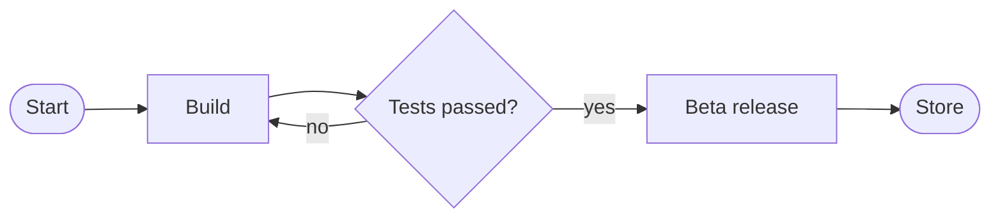

# Mobile app v2 launch

Launch plan for the new mobile app, with backlog, risks and release flow.

## Sprint backlog

| Title | Description | Priority | Assignee |
|---|---|---|---|
| Passkey sign-in | Replace the password with passkeys on iOS and Android | High | @giulia |
| Push notifications | Segment by language | Medium | @marco |
| Dark mode | Polish the contrasts | Low | |

- [ ] Update the store screenshots

> **Speaker notes:** start from the high priorities.

## Risks and ideas

- Apple review slower than expected
- Marketing budget not approved yet
- Idea: public beta with 500 users

## Release flow

