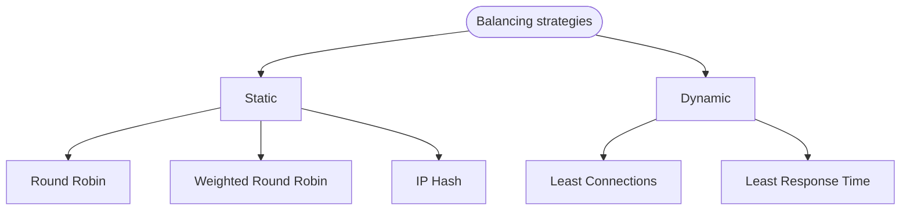
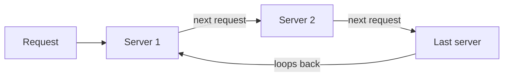

# Load balancing strategies

We found 5 balancing strategies that could be implemented, 3 static and 2 dynamic.

## Overview



The 3 static algorithms are stateless, so we do not need a shared cache between different replicas because the behaviour is always the same.

For the 2 dynamic algorithms, we could use a shared cache to improve the final behaviour, but it is not mandatory.

## Round Robin

### How it works



1. A request is sent to the first server in the list.
2. The next request is sent to the second server, and so on.
3. After the last server in the list, the algorithm loops back to the first server.

### When to use

- When all servers have similar processing capabilities and are equally capable of handling requests.
- When simplicity and even distribution of load are more critical.

### Benefits

- Simple to implement and understand.
- Ensures even distribution of traffic.

### Drawbacks

- Does not consider server load or response time.
- Can lead to inefficiencies if servers have different processing capabilities.

## Weighted Round Robin

### How it works

1. Each server is assigned a weight based on its processing power or available resources.
2. Servers with higher weights receive a proportionally larger share of incoming requests.

### When to use

- When servers have different processing capabilities or available resources.
- When you want to distribute the load based on the capacity of each server.

### Benefits

- Balances load according to server capacity.
- More efficient use of server resources.

### Drawbacks

- Slightly more complex to implement than simple Round Robin.
- Does not consider the current server load or response time.

## IP Hash

### How it works


Calculates a hash value from the client's IP address and uses it to determine the server to route the request.

### When to use

- When you need session persistence, as requests from the same client are always directed to the same server.

### Benefits

- Simple to implement.
- Useful for applications that require sticky sessions.

### Drawbacks

- Can lead to uneven load distribution if certain IP addresses generate more traffic than others.
- Lacks flexibility if a server goes down, as the hash mapping may need to be reconfigured.

## Least Connections

### How it works

1. Monitor the number of active connections on each server.
2. Assigns incoming requests to the server with the least number of active connections.

### When to use

- When you want to distribute the load based on the current number of active connections.
- When servers have similar processing capabilities but may have different levels of concurrent connections.

### Benefits

- Balances load more dynamically based on the current server load.
- Helps prevent any server from becoming overloaded with a high number of active connections.

### Drawbacks

- It may not be optimal if servers have different processing capabilities.
- Requires tracking active connections for each server.

## Least Response Time

### How it works

1. Monitors the response time of each server.
2. Assigns incoming requests to the server with the fastest response time.

### When to use

- When you have servers with varying response times and want to route requests to the fastest server.

### Benefits

- Minimizes overall latency by selecting the server with the fastest response time.
- Can adapt dynamically to changes in server response times.
- Helps improve the user experience by providing quick responses.

### Drawbacks

- Requires accurate measurement of server response times, which can be challenging in distributed systems.
- Other factors, such as server load or connection count, may not be considered.

## Choose the right algorithm

| Algorithm | Type | Distribution | Best for |
|---|---|---|---|
| Round Robin | Static | Simple and even distribution | Homogeneous servers |
| Weighted Round Robin | Static | Based on server capacity | Heterogeneous environments |
| IP Hash | Static | Ensures session persistence | Stateful applications |
| Least Connections | Dynamic | Dynamically balances based on load | Varying workloads |
| Least Response Time | Dynamic | Optimizes for fastest response | Environments with varying server performance |

## Implementations

Below a simple implementation for every algorithm:

```python
import random
import time
import hashlib


class Server:
    def __init__(self, url, weight=1):
        self.url = url
        self.weight = weight

    def invoke(self, path):
        print(f"invoking url: {self.url}{path}")
        # simulate a delay of the invokation
        delay = random.uniform(0.1, 1.0)
        time.sleep(delay)


class RoundRobin:
    def __init__(self, servers):
        self.servers = servers
        self.current_index = -1

    def __get_next_server(self):
        self.current_index = (self.current_index + 1) % len(self.servers)
        return self.servers[self.current_index]

    def invoke(self, url):
        self.__get_next_server().invoke(url)


class WeightedRoundRobin:
    def __init__(self, servers):
        self.servers = servers
        self.weights = [server.weight for server in servers]
        self.current_index = -1
        self.current_weight = 0

    def __get_next_server(self):
        while True:
            self.current_index = (self.current_index + 1) % len(self.servers)
            if self.current_index == 0:
                self.current_weight -= 1
                if self.current_weight <= 0:
                    self.current_weight = max(self.weights)
            if self.weights[self.current_index] >= self.current_weight:
                return self.servers[self.current_index]

    def invoke(self, url):
        self.__get_next_server().invoke(url)


class IPHash:
    def __init__(self, servers):
        self.servers = servers

    def __get_next_server(self, client_ip):
        hash_value = hashlib.md5(client_ip.encode()).hexdigest()
        index = int(hash_value, 16) % len(self.servers)
        return self.servers[index]

    def invoke(self, url):
        # simulate client ip on requests
        client_ips = ["192.168.0.1", "192.168.0.2", "192.168.0.3", "192.168.0.4"]
        client_ip = client_ips[random.randint(0, 3)]
        print(f"request coming from IP: {client_ip}")
        self.__get_next_server(client_ip).invoke(url)


class LeastConnections:
    def __init__(self, servers):
        self.servers = {server: 0 for server in servers}

    def __get_next_server(self):
        # Find the minimum number of connections
        min_connections = min(self.servers.values())
        # Get all servers with the minimum number of connections
        least_loaded_servers = [
            server for server, connections in self.servers.items() if connections == min_connections
        ]
        # Select a random server from the least loaded servers
        selected_server = random.choice(least_loaded_servers)
        self.servers[selected_server] += 1
        return selected_server

    def __release_connection(self, server):
        if self.servers[server] > 0:
            self.servers[server] -= 1

    def invoke(self, url):
        server = self.__get_next_server()
        server.invoke(url)
        self.__release_connection(server)


class LeastResponseTime:
    def __init__(self, servers):
        self.servers = servers
        self.response_times = [0] * len(servers)

    def __get_next_server(self):
        min_response_time = min(self.response_times)
        min_index = self.response_times.index(min_response_time)
        return self.servers[min_index]

    def __update_response_time(self, server, response_time):
        index = self.servers.index(server)
        self.response_times[index] = response_time

    def invoke(self, url):
        server = self.__get_next_server()
        pre_invoke_time = round(time.time() * 1000)
        server.invoke(url)
        post_invoke_time = round(time.time() * 1000)
        response_time = post_invoke_time - pre_invoke_time
        print(f"Response in milliseconds for server {server.url} equal to {response_time}")
        self.__update_response_time(server, response_time)


servers = [Server("http://server-1", 3), Server("http://server-2"), Server("http://server-3")]
iterations = int(input("Enter number of iterations: "))

print("\nRound robin implementation\n")
load_balancer = RoundRobin(servers)
for i in range(iterations):
    load_balancer.invoke("/path/to/method")

print("\nWeighted round robin implementation\n")
load_balancer = WeightedRoundRobin(servers)
for i in range(iterations):
    load_balancer.invoke("/path/to/method")

print("\nIP hash implementation\n")
load_balancer = IPHash(servers)
for i in range(iterations):
    load_balancer.invoke("/path/to/method")

print("\nLeast connections implementation\n")
load_balancer = LeastConnections(servers)
for i in range(iterations):
    load_balancer.invoke("/path/to/method")

print("\nLeast response time implementation\n")
load_balancer = LeastResponseTime(servers)
for i in range(iterations):
    load_balancer.invoke("/path/to/method")
```

## Output

Output of a run with 10 iterations, servers `server-1` (weight 3), `server-2` and `server-3`.

### Round robin

```text
invoking url: http://server-1/path/to/method
invoking url: http://server-2/path/to/method
invoking url: http://server-3/path/to/method
invoking url: http://server-1/path/to/method
invoking url: http://server-2/path/to/method
invoking url: http://server-3/path/to/method
invoking url: http://server-1/path/to/method
invoking url: http://server-2/path/to/method
invoking url: http://server-3/path/to/method
invoking url: http://server-1/path/to/method
```

### Weighted round robin

```text
invoking url: http://server-1/path/to/method
invoking url: http://server-1/path/to/method
invoking url: http://server-1/path/to/method
invoking url: http://server-2/path/to/method
invoking url: http://server-3/path/to/method
invoking url: http://server-1/path/to/method
invoking url: http://server-1/path/to/method
invoking url: http://server-1/path/to/method
invoking url: http://server-2/path/to/method
invoking url: http://server-3/path/to/method
```

### IP hash

```text
request coming from IP: 192.168.0.3
invoking url: http://server-1/path/to/method
request coming from IP: 192.168.0.3
invoking url: http://server-1/path/to/method
request coming from IP: 192.168.0.4
invoking url: http://server-3/path/to/method
request coming from IP: 192.168.0.4
invoking url: http://server-3/path/to/method
request coming from IP: 192.168.0.4
invoking url: http://server-3/path/to/method
request coming from IP: 192.168.0.3
invoking url: http://server-1/path/to/method
request coming from IP: 192.168.0.2
invoking url: http://server-3/path/to/method
request coming from IP: 192.168.0.4
invoking url: http://server-3/path/to/method
request coming from IP: 192.168.0.1
invoking url: http://server-3/path/to/method
request coming from IP: 192.168.0.3
invoking url: http://server-1/path/to/method
```

### Least connections

```text
invoking url: http://server-3/path/to/method
invoking url: http://server-2/path/to/method
invoking url: http://server-2/path/to/method
invoking url: http://server-1/path/to/method
invoking url: http://server-1/path/to/method
invoking url: http://server-2/path/to/method
invoking url: http://server-3/path/to/method
invoking url: http://server-1/path/to/method
invoking url: http://server-2/path/to/method
invoking url: http://server-2/path/to/method
```

### Least response time

```text
invoking url: http://server-1/path/to/method
Response in milliseconds for server http://server-1 equal to 449
invoking url: http://server-2/path/to/method
Response in milliseconds for server http://server-2 equal to 847
invoking url: http://server-3/path/to/method
Response in milliseconds for server http://server-3 equal to 873
invoking url: http://server-1/path/to/method
Response in milliseconds for server http://server-1 equal to 943
invoking url: http://server-2/path/to/method
Response in milliseconds for server http://server-2 equal to 345
invoking url: http://server-2/path/to/method
Response in milliseconds for server http://server-2 equal to 845
invoking url: http://server-2/path/to/method
Response in milliseconds for server http://server-2 equal to 967
invoking url: http://server-3/path/to/method
Response in milliseconds for server http://server-3 equal to 832
invoking url: http://server-3/path/to/method
Response in milliseconds for server http://server-3 equal to 236
invoking url: http://server-3/path/to/method
Response in milliseconds for server http://server-3 equal to 442
```

## YAML configurations

Based on the five algorithms above, we can define two properties:

| Property | Required | Description |
|---|---|---|
| `algorithm` | Yes, to configure balancing | The balancing algorithm used to route the traffic between servers: `round_robin`, `weighted_round_robin`, `ip_hash`, `least_connections` or `least_response_time`. Without it, `round_robin` is used as default value. |
| `weights` | Only with `weighted_round_robin` | A list with the name of the model and its weight. `model_name` must be equal to the `model_name` property inside the models definition section and is required. `weight` is a positive integer number and is equal to 1 if not defined. |

### Round robin

```yaml
models:
  - model_name: openai
    [...]
  - model_name: azure
    [...]
  - model_name: deepseek
    [...]
balancing:
  algorithm: round_robin
```

### Weighted round robin

```yaml
models:
  - model_name: openai
    [...]
  - model_name: azure
    [...]
  - model_name: deepseek
    [...]
balancing:
  algorithm: weighted_round_robin
  weights:
    - model_name: openai
      weight: 3
    - model_name: azure
    - model_name: deepseek
      weight: 2
```

### IP hash

```yaml
models:
  - model_name: openai
    [...]
  - model_name: azure
    [...]
  - model_name: deepseek
    [...]
balancing:
  algorithm: ip_hash
```

### Least connections

```yaml
models:
  - model_name: openai
    [...]
  - model_name: azure
    [...]
  - model_name: deepseek
    [...]
balancing:
  algorithm: least_connections
```

### Least response time

```yaml
models:
  - model_name: openai
    [...]
  - model_name: azure
    [...]
  - model_name: deepseek
    [...]
balancing:
  algorithm: least_response_time
```
